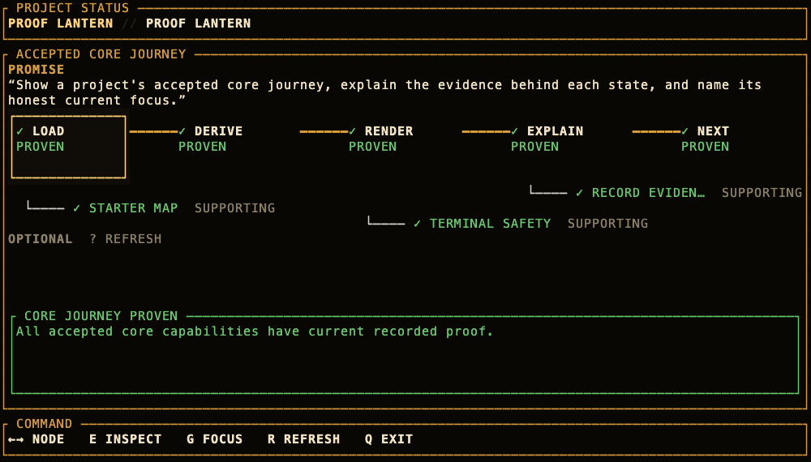

# Proof Lantern

[](https://github.com/stoicpickle/prooflantern/actions/workflows/ci.yml)

Proof Lantern is an experimental, local-first terminal tool that shows what a
project has decided to build, what appears to exist, what has actually been
proven, and what still breaks the core user journey. It then names one honest
current focus and explains what evidence would move the project forward.



## Start here

You need a terminal at least 100 columns by 30 rows. Prebuilt preview archives
for macOS, Linux, and Windows appear on the
[Releases page](https://github.com/stoicpickle/prooflantern/releases) when a
version is tagged. They include checksums and build provenance; see
[Release integrity](docs/RELEASE_INTEGRITY.md).

To run directly from source instead, install
[Rust](https://www.rust-lang.org/tools/install) 1.88 or newer.

To try the built-in Recipe Box example without creating any files:

```sh
git clone https://github.com/stoicpickle/prooflantern.git
cd prooflantern
cargo run -- demo
```

To install the `proof-lantern` command from this checkout:

```sh
cargo install --locked --path .
proof-lantern demo
```

You can also install it without keeping a clone:

```sh
cargo install --locked --git https://github.com/stoicpickle/prooflantern.git
```

The demo is synthetic and is always labeled that way. It is designed to show
the visual language before you make a map for your own project.

## Map your own project

After installing the command above, open the folder containing your own project
and run:

```sh
proof-lantern init --guided .
```

Guided setup asks for the project's name, the useful result a user should reach,
and 3–5 core steps with a visible check for each. It previews the journey before
saving. Choose `edit` to revise your answers (Enter keeps the previous answer),
`save` to create `.proof-lantern/project.yml`, or `cancel` to leave without saving.
You can also type `:cancel` at any question. Nothing is created before Save, and
an existing map is never overwritten. Setup does not scan or run your code.

Then view your map:

```sh
proof-lantern .
```

Prefer editing a file? `proof-lantern init .` still creates the original commented
starter without questions, including when output is redirected. Replace its
promise and placeholder steps in `.proof-lantern/project.yml` before using it.
The guided mode needs interactive input and output; it is not a piped-input API.

New capabilities begin as `UNKNOWN`. That does not mean they are broken. It
means you have recorded your intention but have not yet recorded technical
evidence. Start with roughly three to five core capabilities; Proof Lantern is
most useful when the map stays focused on the central experience.

After performing the observable check described by `proof_needed`, record what
you actually saw:

```sh
proof-lantern record step-1 passed --summary "I completed the visible starting step." .
```

Guided maps use IDs `step-1`, `step-2`, and so on. Use the ID from your own map:
the plain starter uses `start`, `outcome`, and `return`. `proof-lantern next .`
shows the next step's ID and command; `proof-lantern explain step-1 .` shows its
full check. If a check failed, record `failed`, not `passed`.

The claim can be `built`, `missing`, `passed`, or `failed`. This command writes
`.proof-lantern/manual-evidence.json`; it never rewrites your commented
`project.yml`. When you record a newer result in the same category, the older
manual result stays visible as `STALE` history rather than being deleted.

To notice when the files you checked change, attach their paths when recording:

```sh
proof-lantern record step-1 passed --summary "I completed the starting step." --input src/main.rs .
```

Replace `src/main.rs` with a file from your project; repeat `--input` for each
relevant source, test, configuration, or result file. Paths are relative to the
map root. The receipt records the time, required check, and selected file hashes.
If those bytes or the required check change, refreshing or reopening the map shows
`NEEDS RECHECK` and the old result no longer counts as current proof.

This remains a human observation: Proof Lantern does not run or authenticate
the check. Files not selected are not tracked. Without `--input`, the receipt
tracks only the required check text; older evidence without receipts remains
usable and is labeled `NO CHANGE TRACKING`.

See [Writing a project map](docs/PROJECT_FORMAT.md) for copyable evidence,
supporting-capability, and optional-capability examples.

## Read the map

| State | Meaning |
| --- | --- |
| `✓ PROVEN` | Current recorded proof says the capability works. |
| `◐ BUILT / UNPROVEN` | Implementation appears to exist, but no passing proof is current. |
| `╳ MISSING` | Explicit current evidence says required implementation is absent. |
| `! PROOF FAILED` | A current recorded check failed. |
| `? UNKNOWN` | No current technical evidence establishes whether it exists or works. |
| `⚠ CONFLICTING` | Current evidence disagrees, so Proof Lantern refuses to guess. |

Missing evidence produces `UNKNOWN`, never `MISSING`. Code existing is not the
same as behavior being proven.

Inside the TUI:

- `←` / `→` or `h` / `l`: select a capability
- `e` or `Enter`: open or close the compact inspector
- `g`: return to the current focus
- `r`: reload a project map and recheck receipts without closing it
- `q` or `Ctrl-C`: exit and restore the terminal

Plain terminal commands expose the same evaluated model:

```sh
proof-lantern next .
proof-lantern explain capability-id .
```

At 128×36 and above, the inspector remains visible beside the journey.

After recording evidence in another terminal or editing your map, press `r`.
Refresh preserves the selected step and inspector; if that step was removed,
selection moves to the new current focus. The header confirms the reload and
counts steps needing recheck. It does not automatically watch files or run tests.

If a file is missing or invalid, `REFRESH FAILED / OUTDATED SNAPSHOT` marks the
last successfully loaded map. Fix the source file and press `r` again. For the
full error, run `proof-lantern next .` from the map's project folder. A failed
reload does not change the saved files or silently present the old map as current.
Navigation and quitting remain available during refresh. The built-in demo has
no project folder to reload, so it does not offer `r`.

## Evidence boundary

Proof Lantern deliberately separates authority:

- `.proof-lantern/project.yml` is human-owned. It contains the promise,
  accepted capabilities, journey order, proof requirements, notes, and manual
  evidence.
- `.proof-lantern/manual-evidence.json` contains evidence deliberately recorded
  with the `record` command. It is separate so the command never reformats or
  removes comments from human-authored intent.
- `.proof-lantern/observations.json` is replaceable machine evidence. Static
  scans may establish only that implementation appears present. Imported test
  results may record passing or failing verification.
- Display states and the current focus are derived. They are never stored as
  editable progress labels.

Current file evidence must resolve inside the project root and cite real,
readable lines. Stale historical evidence remains visible without counting as
current proof. Proof Lantern validates whether a citation can be inspected; it
cannot decide whether the cited text truly proves its summary.

## Prototype scope

This public preview proves that a small accepted journey can be rendered,
inspected, and prioritized without turning source files into fake progress. It
also exercises real `q`, Ctrl-C, error, and panic terminal restoration paths.

It does not yet generate journeys, scan repositories, automatically watch files, execute
project code, or edit intent inside the TUI. Core capabilities are rendered as
one ordered line; dependency-shaped journey visualization remains future work.

## Development

```sh
cargo fmt --check
cargo clippy --all-targets --all-features -- -D warnings
cargo test --all-targets --all-features
git diff --check
```

Rendered proof is generated through the same Ratatui `TestBackend` used by the
snapshot tests. See [proof/README.md](proof/README.md) for the commands.

The original product kickoff remains in
[`BUILD_MAP_CODEX_KICKOFF.md`](BUILD_MAP_CODEX_KICKOFF.md); “build map” is the
generic visualization, while Proof Lantern is the product name.

Contributions are welcome; start with [CONTRIBUTING.md](CONTRIBUTING.md).
Maintainers preparing a tagged preview should also read
[Release integrity](docs/RELEASE_INTEGRITY.md).

## License

Proof Lantern is available under either the [MIT License](LICENSE-MIT) or the
[Apache License 2.0](LICENSE-APACHE), at your option.
